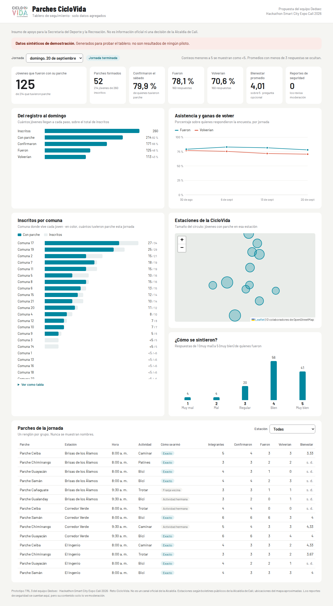

<h1 align="center">🚲 Parches CicloVida</h1>

<p align="center">
  <b>Arma tu parche para la CicloVida de Cali: te unimos con gente de tu hora, tu estación y tu ritmo.</b><br/>
  Prototipo TRL 3 del equipo <b>Dedsec</b> · Hackathon Smart City Expo Cali 2026
</p>

<p align="center">
  <a href="https://parches-app.onrender.com"></a>
  <a href="https://parches-tablero.onrender.com"></a>
  <a href="https://parches-backend.onrender.com/api/salud"></a>
</p>

<p align="center">
  
</p>

## El problema

La CicloVida de Cali tiene 11 estaciones y miles de personas cada domingo, pero mucha gente joven no va porque no tiene con quién ir. Parches CicloVida arma grupos pequeños de gente afín para que el domingo no salgas solo.

## Cómo funciona

1. **Registro con correo institucional.** Cada estudiante verifica su correo y crea su perfil.
2. **Match automático.** El sistema lo une al parche que ya tiene gente con su hora (8:00, 9:30 u 11:00), su estación y su actividad (bici, patines, trotar o caminar). Si no hay ninguno, queda en lista de espera y recibe un aviso en la app y por **Telegram** apenas aparezca uno.
3. **k-means el sábado.** A las 5:00 p. m. el algoritmo divide cada parche en grupos de 3 a 6 personas. A las 7:00 p. m. llega la notificación para confirmar.
4. **Encuesta del domingo.** Al terminar la jornada, la app pregunta si fuiste, si volverías y, si quieres, cómo te sentiste.
5. **Tablero para la Secretaría.** Muestra solo cifras agregadas por comuna y por grupo. Nunca datos personales.

Además incluye un mapa interactivo de las 11 estaciones, un foro comunal, un historial de domingos, el quiz "Tu estilo de parche" y un bot de **Gemini con function calling** que responde con los datos reales de la app.

## Stack

| Capa | Tecnología |
|---|---|
| App móvil y web | Flutter · Dart · flutter_map + OpenStreetMap |
| Backend | FastAPI · SQLModel · SQLite |
| Emparejamiento | k-means propio (funciones puras con pruebas) |
| Integraciones | Bot de Telegram · Google Gemini |
| Despliegue | Render (Blueprint en [`render.yaml`](render.yaml)) |

## Privacidad

Cumple con la **Ley 1581 de 2012 (hábeas data)**: aviso de privacidad en el registro, registro de cada autorización con su fecha, pregunta de bienestar opcional y borrado de datos desde Ajustes. El piloto es para jóvenes de 18 a 28 años.

## Correr en local

```bash
# Backend
cd parches-ciclovida/backend
python -m venv .venv && .venv\Scripts\activate   # en Linux/macOS: source .venv/bin/activate
pip install -r requirements.txt
copy .env.example .env                           # en Linux/macOS: cp
uvicorn app.main:app --reload                    # tablero en http://localhost:8000/tablero/

# App
cd ../app
flutter pub get
flutter run
```

## Documentación completa

- [README técnico](parches-ciclovida/README.md): requisitos del reto y dónde está cada uno, el bot de Telegram, las variables de entorno y la demo.
- [Reporte de emparejamiento](parches-ciclovida/docs/reporte_emparejamiento.md)
- [Guion del pitch](parches-ciclovida/docs/guion_pitch.md)

## Equipo Dedsec

Bylen Naspiran ([@Byleny](https://github.com/Byleny)) · Natalia Giraldo ([@NataliaGiraldoA](https://github.com/NataliaGiraldoA)) · Kevin López
